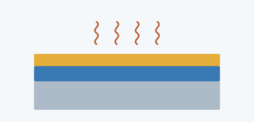
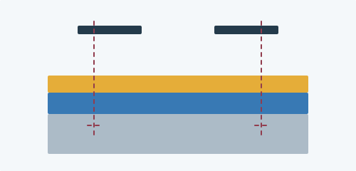
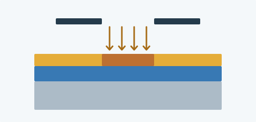
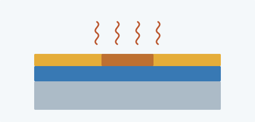
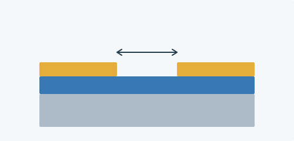

<!-- source: zh-TW/2-process-modules/04-lithography/README.md | sha: 0f6406fdf103 -->

# 第 4 章　光刻：把电路图「印」到晶圆上

> 📍 **晶圆位置**
>
> - 前一站：薄膜沉积，晶圆表面已经铺好一层材料
> - **本章：光刻，在这层材料上定义出电路图形**
> - 下一站：刻蚀，依照图形把材料挖出形状

---

## 为什么光刻这么重要

芯片上的电路是由几十层图形一层一层叠起来的，每一层都要经过一次光刻，决定「哪里留下材料、哪里去掉材料」。

光刻很像摄影：

- **掩模版**就像底片，上面有电路图形
- **光刻胶**就像相纸，照到光的地方会起化学变化
- **曝光机**就像相机，把掩模版上的图形缩小投影到晶圆上

不同的是，光刻印出来的图形要精准到纳米等级，而且每一层都要和前一层对得刚刚好。所以光刻是整个工艺中最昂贵、最关键的步骤。

<!-- 图：摄影与光刻的对照图（光源、底片／掩模版、镜头、相纸／光刻胶） -->

> [!NOTE]
> **📖 名词｜光刻（Lithography）**
>
> - **定义**：利用光把掩模版上的图形转移到晶圆光刻胶上的工艺。
> - **现场用法**：光刻区使用黄色照明，现场通常直接叫「黄光」，例如「这批卡在黄光」。
> - **相关名词**：掩模版、光刻胶、曝光机
> - **常见混淆**：光刻只负责「定义图形」，真正把材料挖掉的是下一站的刻蚀。

---

## 光刻的三个主角

**掩模版（Reticle / Mask）**：一片带有电路图形的石英板。每一层电路都需要一片自己的掩模版，一个先进产品可能需要数十片。曝光机会把掩模版上的图形缩小四倍投影到晶圆上。

**光刻胶（Photoresist，简称 PR）**：一种对光敏感的材料。涂在晶圆上曝光后，照到光的区域化学性质会改变，再用显影液溶掉一部分，留下图形。

**曝光机（Scanner）**：一次曝光晶圆上的一小块区域（称为一个**曝光区**），曝完一块再移到下一块，一片晶圆要重复上百次才能曝完。

---

## 光刻的流程

光刻不只是「曝光」一个动作，而是一连串步骤。负责涂布和显影的设备会和曝光机直接相连，晶圆在中间自动传送。

**表面处理 → 涂布光刻胶 → 软烘 → 对准与曝光 → 曝光后烘烤 → 显影 → 检查**

1. **表面处理**：让晶圆表面变得容易让光刻胶附着。
2. **涂布光刻胶**：把光刻胶滴在晶圆中心，高速旋转让它均匀摊开。
3. **软烘**：加热赶走光刻胶里的溶剂。
4. **对准与曝光**：先找到前一层留下的对准标记，确定位置后再曝光。
5. **曝光后烘烤**：加热让光刻胶的化学反应完成，温度和时间会直接影响图形尺寸。
6. **显影**：用显影液溶掉不要的光刻胶，图形就出现了。
7. **检查（ADI）**：测量图形的尺寸、对准程度，以及有没有缺陷。

<!-- 图：光刻流程示意（涂布、曝光、显影三个阶段的晶圆剖面） -->

> [!TIP]
> **🔧 Know-how｜光刻是「可以重来」的最后机会**
>
> - **情境**：检查发现图形尺寸或对准不合格。
> - **做法**：把光刻胶全部去掉，重新涂布、曝光，这叫 **Rework**。
> - **为什么**：这时晶圆上只多了一层光刻胶，底下的材料还没被动过。
> - **没做会怎样**：一旦进入刻蚀，错误的图形就会永久刻进材料里，晶圆可能只能报废。所以工厂的系统会在检查不合格时自动挡下这批晶圆。
> - **相关章节**：[第 6 章 刻蚀](../../2-process-modules/06-etching/README.md)、[第 18 章 异常处理与工程变更](../../4-yield-and-quality/18-abnormality-handling/README.md)

---

## 怎么印得更小

想印出更细的图形，最直接的方法是**用波长更短的光**，就像用更细的笔可以写出更小的字。

| 光源 | 波长 |
|---|---|
| 汞灯 | 436、365 nm |
| KrF 激光（DUV） | 248 nm |
| ArF 激光（DUV） | 193 nm |
| EUV（极紫外光） | 13.5 nm |

193 nm 用了很多年，产业在这期间也发展出各种技巧继续往下缩：

- **浸没式光刻**：在镜头和晶圆之间加一层水，让分辨能力再提升。
- **OPC**：光通过极小的图形时会变形，所以故意把掩模版上的图形画歪，让它印出来刚好正确。
- **多重曝光**：一次印不出来，就拆成两次或更多次来做，代价是步骤和成本都增加。

---

## EUV：最先进的光刻

EUV 的波长只有 13.5 nm，可以印出极细的图形，但它非常难做：空气和玻璃都会吸收 EUV，所以整台机器的光路必须在真空中，而且不能用透镜，只能用特殊的反射镜。EUV 从研究到量产花了二十多年。

> [!NOTE]
> **📖 名词｜EUV（Extreme Ultraviolet，极紫外光光刻）**
>
> - **定义**：使用 13.5 nm 波长光源的光刻技术，最先进工艺的关键层都依赖它。
> - **现场用法**：「这层是 EUV 层」代表这层图形最细、成本最高。
> - **相关名词**：DUV（深紫外光，指 248 nm 和 193 nm 的光源）、反射式掩模版
> - **常见混淆**：一个产品并不是每层都用 EUV，只有最关键的几层才用，其他层仍然用 DUV 以控制成本。

---

## 对准：每一层都要对得刚好

电路一层叠一层，例如金属线必须准确接到下面的接触点。如果某一层偏掉了，上下层就接不起来，电路会断路或短路。

在先进工艺中，层与层之间容许的对准误差只有几纳米，大约是几十个原子的宽度。

> [!NOTE]
> **📖 名词｜CD 与 Overlay**
>
> - **定义**：CD（Critical Dimension，关键尺寸）是图形最需要控制的尺寸，例如线宽；Overlay 是这一层和前一层的对准误差。
> - **现场用法**：「CD 偏大 2 nm」「Overlay 往 X 方向偏」，这是光刻工程师最常讲的两个词。
> - **相关名词**：ADI、对准标记
> - **常见混淆**：CD 不等于工艺节点的「几纳米」，见[第 14 章](../../3-integration/14-process-nodes/README.md)。

---

## 常见异常

| 异常 | 可能原因 | 结果 |
|---|---|---|
| CD 偏大或偏小 | 曝光能量偏移、曝光后烘烤异常 | 线宽不合格 |
| 局部失焦 | 晶圆背面有颗粒把晶圆顶高 | 局部图形模糊 |
| Overlay 超规 | 设备对准误差、晶圆变形 | 上下层接不上 |
| 光刻胶缺陷 | 涂布时有气泡或颗粒 | 图形缺损 |

> [!TIP]
> **🔧 Know-how｜为什么光刻区是黄色的？**
>
> - **情境**：第一次进晶圆厂的人，常会注意到光刻区的灯光是黄色的。
> - **做法**：光刻区的照明会滤掉短波长的光，只留下黄光。
> - **为什么**：光刻胶对紫外光和蓝光敏感，一般白光就足以让它起反应，黄光则几乎不会。
> - **没做会怎样**：还没曝光的光刻胶被环境光照到，图形质量会变差。
> - **相关章节**：[第 1 章 晶圆厂如何运行](../../0-before-you-start/01-how-a-fab-works/README.md)

---

<!-- process-steps:start -->
## 分步图解

把设计图形转到光刻胶上。这个例子使用正胶和透射式曝光的示意光路。

每点击一个步骤，就展开该步的剖面和讲解。图按教学需要放大了薄层。
灰色是硅，蓝色是待加工薄膜，黄色是光刻胶。深橙色标出受光后的胶。

[下载交互动画](../animations/index.html)（在文件页下载 HTML，双击打开后选择「光刻」）。

第 1 步　准备表面

*先看到灰色硅基底和蓝色目标薄膜。*

**这一步做什么**

处理已经铺好目标薄膜的表面，去除会影响涂胶的残留。

**为什么做**

油污、颗粒或水分可能让光刻胶铺不匀，或者在后续步骤里脱落。

第 2 步　旋涂光刻胶

*蓝色目标膜上多了一整层黄色胶。*

**这一步做什么**

在晶圆上滴胶并旋转，让感光材料摊成一层薄膜。

**为什么做**

后面要用光在这层胶里写下图形，胶层厚薄一致有助于图形尺寸稳定。

第 3 步　软烘

*橙色波纹表示加热，胶层依旧连续。*

**这一步做什么**

受控加热涂好的光刻胶，让部分溶剂蒸发。

**为什么做**

让胶层稳定下来，便于后续对准和曝光。

第 4 步　对准

*虚线连接上下两组对准标记。*

**这一步做什么**

让掩模版上的本层图形对齐晶圆上已有的定位标记。

**为什么做**

后续接触孔需要落在下层的正确位置。即使孔径正确，位置偏了也可能接不上。

第 5 步　曝光

*中间一段胶变色，仍然没有开口。*

**这一步做什么**

把掩模版的图形投到胶上，改变受光区域的化学性质。

**为什么做**

显影液随后就能区分受光和未受光的地方。

第 6 步　曝光后烘烤

*受光区保持标记。是否使用这一步取决于胶的体系。*

**这一步做什么**

按所用胶的要求加热，推进曝光触发的化学反应。

**为什么做**

有些胶需要这一步才能形成稳定的溶解差异，便于控制显影后的形状。

第 7 步　显影

*黄色胶中间出现开口，下面的蓝膜依然连续。*

**这一步做什么**

用显影液去掉更容易溶解的胶。图中的正胶在受光区被去掉。

**为什么做**

露出下一道工艺要加工的区域，并让剩下的胶保护其他地方。

第 8 步　检查胶图形

*两端带箭头的尺寸线指向胶开口。*

**这一步做什么**

检查开口宽度、与下层的位置偏差以及图形缺陷。

**为什么做**

在刻蚀或注入改变晶圆之前发现问题，便于评估能否返工。

延伸阅读 [ASML 芯片制造流程](https://www.asml.com/en/company/stories/2021/semiconductor-manufacturing-process-steps)。
<!-- process-steps:end -->

---

## 本章重点

1. 光刻负责在晶圆上定义图形，每一层电路都要经过一次。
2. 流程包括涂布光刻胶、曝光、显影和检查，不只是曝光一个动作。
3. 波长越短，能印的图形越细，最先进的是 EUV。
4. CD 看尺寸、Overlay 看对准，是光刻最重要的两个指标。
5. 光刻是唯一可以重来的关卡，一旦进入刻蚀就无法挽回。

---

## 延伸阅读

- Peter Van Zant，《Microchip Fabrication》，光刻相关章节
- James D. Plummer、Michael D. Deal、Peter B. Griffin，《Silicon VLSI Technology》，光刻章节
- Chris Mack，《Fundamental Principles of Optical Lithography》

---

[← 上一章：第 3 章 从沙子到晶圆](../../1-fundamentals/03-sand-to-wafer/README.md) ｜ [目录](../../README.md) ｜ [下一章：第 5 章 薄膜 →](../../2-process-modules/05-thin-films/README.md)
