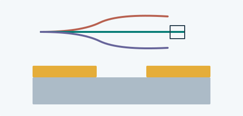
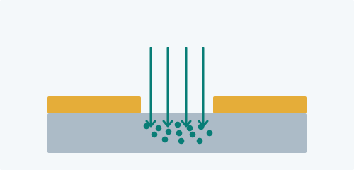
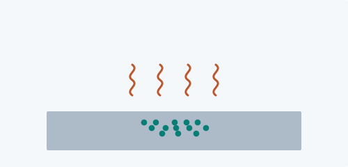
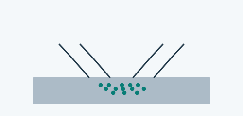

<!-- source: zh-TW/2-process-modules/07-ion-implantation/README.md | sha: 8285574c395f -->

# 第 7 章　离子注入与热处理：改变硅的电学特性

> 📍 **晶圆位置**
>
> - 前一站：光刻，光刻胶已经挡住不需要注入的区域
> - **本章：离子注入与退火，在指定区域加入杂质，改变电学特性**
> - 下一站：去除光刻胶、清洗

---

## 为什么要注入

第 2 章提到，硅要加入少量杂质才会变成 N 型或 P 型。晶体管需要很多不同的掺杂区域，例如 N 井、P 井、源极、漏极，而且每一区的**位置、浓度和深度**都要精准控制。

早期的做法是把晶圆放在高温的杂质气体中，让杂质慢慢扩散进硅里，但很难精准控制。现代工艺改用**离子注入**：把杂质原子变成离子，加速后直接「射」进硅里。就像用一把能精准控制子弹数量和速度的枪，把杂质打到指定的位置和深度。

---

## 注入机怎么运行

**离子源 → 质量分析 → 加速 → 扫描 → 晶圆**

1. **离子源**：把含有硼、磷或砷的气体变成带电的离子。
2. **质量分析**：让离子通过磁场，不同重量的离子转弯的程度不同，只有需要的那一种离子能通过。
3. **加速**：用电场把离子加速到需要的能量。
4. **扫描**：让离子束均匀地扫过整片晶圆。

晶圆上有光刻胶覆盖的地方，离子会被光刻胶挡住，所以只有光刻胶开口的区域会被注入。这就是为什么注入前要先做一次光刻。

<!-- 图：离子注入机示意（离子源、质量分析磁铁、加速段、扫描、晶圆） -->

---

## 两个最重要的参数

- **剂量**（Dose）：每单位面积打进多少个原子，决定掺杂的浓度。
- **能量**（Energy）：离子的速度有多快，决定打得多深。

> [!NOTE]
> **📖 名词｜剂量与能量（Dose / Energy）**
>
> - **定义**：剂量是单位面积注入的原子数量，能量是离子被加速的程度。
> - **现场用法**：「这道的剂量是 1E15」，意思是每平方厘米注入 10 的 15 次方个原子。
> - **相关名词**：注入角度、方块电阻、Vt 调整
> - **常见混淆**：能量越高是打得越深，不是打进越多原子。原子的数量由剂量决定。

硅的晶体里有排列整齐的「隧道」。如果离子刚好沿着隧道方向射入，就会一路滑得太深，称为**沟道效应**。所以注入时通常会让晶圆稍微倾斜一个角度，避开这些隧道。

---

## 退火：修复与激活

离子高速撞进硅里，会把原本整齐排列的硅原子撞乱，而且刚打进去的杂质原子还没有「就定位」，无法发挥作用。所以注入之后要**退火**：把晶圆加热，让晶格修复，杂质原子也移到正确的位置，开始导电，这叫做**激活**。

常见的退火方式从长到短：

- **炉管退火**：在炉管中加热数十分钟以上。
- **快速热退火**（RTA）：用强光在几秒内把晶圆加热到高温。
- **毫秒级退火**：用激光或闪光灯，在极短的时间内只加热晶圆表面。

> [!NOTE]
> **📖 名词｜退火（Anneal）**
>
> - **定义**：通过加热修复晶格损伤，并让杂质激活的工艺。
> - **现场用法**：「注入完还要过一道 RTA。」
> - **相关名词**：激活、扩散、热预算、RTA
> - **常见混淆**：退火不只会修复晶格，也会让杂质往外扩散。温度越高、时间越长，杂质跑得越远，所以退火永远是在「激活」和「扩散」之间取得平衡。

---

## 热预算：加热是有额度的

晶圆在整个工艺中经历的高温总量，称为**热预算**（Thermal Budget）。每一次高温步骤，都会让之前注入的杂质再扩散一点。对尺寸只有几十纳米的晶体管来说，杂质多跑几纳米就可能影响电学特性。

而且一旦晶圆上有了金属导线，温度就必须大幅降低，否则金属和周围的材料会受损。这也是工艺顺序必须仔细安排的原因之一。

完成注入和退火后，工厂通常会用控片测量**方块电阻**（Sheet Resistance），确认掺杂的结果是否正确。

> [!TIP]
> **🔧 Know-how｜注入做错，眼睛看不出来**
>
> - **情境**：一片注入错误的晶圆，外观和正确的晶圆一模一样。
> - **做法**：注入设备的 Recipe 和参数受到特别严格的管控，系统会在开机前再次确认注入的元素、剂量和能量，设备也会实时监测剂量。
> - **为什么**：注入的错误无法用肉眼或一般显微镜看出来，往往要等到几周后的电学特性测试才会发现，而且无法重做。
> - **没做会怎样**：错误一路被带到工艺后段才发现，前面所有加工都白费，还可能已经影响了很多批晶圆。
> - **相关章节**：[第 19 章 晶圆测试](../../5-backend/19-wafer-test/README.md)、[第 23 章 工厂如何被系统管理](../../6-beyond-the-fab/23-fab-systems/README.md)

> [!TIP]
> **🔧 Know-how｜高温步骤要尽量排在前面**
>
> - **情境**：规划一个产品的完整工艺流程。
> - **做法**：需要高温的步骤尽量安排在前面，越后面的步骤温度越低；退火也尽量使用时间最短的方式。
> - **为什么**：杂质的扩散会累积。后面的每一次加热，都会让前面做好的掺杂区域变形。
> - **没做会怎样**：源极和漏极的掺杂扩散得太深、太宽，晶体管的漏电变大、Vt 偏移。
> - **相关章节**：[第 11 章 走一遍完整的 CMOS 流程](../../3-integration/11-cmos-process-flow/README.md)

---

## 常见异常

| 异常 | 可能原因 | 结果 |
|---|---|---|
| 剂量偏移 | Recipe 设定错误、剂量测量异常 | Vt 与电阻偏移 |
| 注入错误的元素或能量 | Recipe 或气体错误 | 电学特性完全错误，通常只能报废 |
| 注入不均匀 | 离子束扫描异常 | 晶圆不同位置的电学特性不同 |
| 光刻胶阻挡不足 | 光刻胶太薄或有缺陷 | 不该注入的区域被注入 |
| 退火温度偏移 | 加热系统异常 | 激活不足或扩散过度 |

---

<!-- process-steps:start -->
## 分步图解

让少量指定元素进入硅中，改变局部电学性质。退火再帮助修复晶格并激活掺杂。

每点击一个步骤，就展开该步的剖面和讲解。图按教学需要放大了薄层。
灰色是硅，黄色是光刻胶，蓝绿色点是掺杂离子或原子。

[下载交互动画](../animations/index.html)（在文件页下载 HTML，双击打开后选择「离子注入」）。

第 1 步　用掩模限定区域

*黄色遮挡层中间露出硅表面。*

**这一步做什么**

在要改变电学性质的位置留出开口，用遮挡层护住其他区域。

**为什么做**

同一片晶圆上有许多器件，只有设计指定的位置需要这次掺杂。

第 2 步　产生并筛选离子

*三种粒子的路径分开，蓝绿色粒子进入后续通道。*

**这一步做什么**

把原料变成带电粒子，再用质量分析选出所需离子。

**为什么做**

带电粒子可以用电场加速。选对元素才能得到预期的掺杂效果。

第 3 步　加速并扫过晶圆

*离子从开口进入硅中，形成一片分散的掺杂区。*

**这一步做什么**

让选出的离子达到所需能量，再用离子束与晶圆的相对运动覆盖目标区域。

**为什么做**

能量影响离子进入多深，剂量控制单位面积打进去多少，扫描让分布更均匀。

第 4 步　去除临时遮挡层

*黄色胶移除。青色掺杂原子仍然留在硅中。*

**这一步做什么**

本例用光刻胶遮挡。注入后去掉胶并清理表面。

**为什么做**

这层胶的任务已经完成，后续热处理需要合适的晶圆表面。

第 5 步　退火修复并激活

*热波纹亮起，青色原子标出待激活或已激活的掺杂区。*

**这一步做什么**

受控加热硅，让被撞乱的晶格恢复，并让一部分掺杂原子进入能发挥电学作用的位置。

**为什么做**

离子打进去就完成了材料引入。还要经过激活，才能获得所需电学特性。

第 6 步　验证电学结果

*探针在掺杂区上方接触表面。*

**这一步做什么**

在控片或测试结构上量电阻等指标，再结合器件要求判断。

**为什么做**

束流参数记录能说明设备跑过什么条件。电学数据能说明硅最终变成了什么样。

延伸阅读 [ASML 芯片制造流程](https://www.asml.com/en/company/stories/2021/semiconductor-manufacturing-process-steps)。
<!-- process-steps:end -->

---

## 本章重点

1. 离子注入把杂质原子加速后射进硅里，精准控制掺杂的位置、浓度和深度。
2. 剂量决定浓度，能量决定深度。
3. 注入会破坏晶格，必须经过退火来修复并激活杂质。
4. 热预算有限，高温会让杂质扩散，所以工艺顺序要仔细安排。
5. 注入错误无法用眼睛看出、也无法重做，因此管控特别严格。

---

## 延伸阅读

- James D. Plummer、Michael D. Deal、Peter B. Griffin，《Silicon VLSI Technology》，离子注入与扩散章节
- Peter Van Zant，《Microchip Fabrication》，掺杂相关章节

---

[← 上一章：第 6 章 刻蚀](../../2-process-modules/06-etching/README.md) ｜ [目录](../../README.md) ｜ [下一章：第 8 章 CMP →](../../2-process-modules/08-cmp/README.md)
